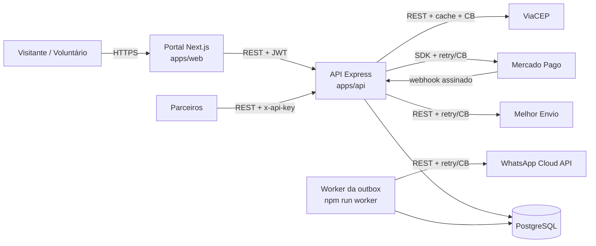

# Arquitetura — Bazar Solidário Digital

## Visão geral dos componentes

A API segue camadas por módulo: `routes → controller → service → repository (Prisma)`.
Integrações externas ficam em `src/integrations/` atrás de interfaces (`PaymentProvider`,
`ShippingProvider`, `CepProvider`, `NotificationProvider`), permitindo trocar a implementação real
por um mock via `INTEGRATIONS_MODE`.

## Decisões técnicas (Fase 1)

| Decisão                                                                                            | Justificativa                                                                                                                  | Disciplina                        |
| -------------------------------------------------------------------------------------------------- | ------------------------------------------------------------------------------------------------------------------------------ | --------------------------------- |
| Monorepo com npm workspaces e `packages/shared`                                                    | Tipos e schemas Zod únicos entre API e portal; validação idêntica no cliente e no servidor                                     | Tópicos Avançados em Programação  |
| Node ≥ 20 (deploy em 20 LTS)                                                                       | Compatibilidade com o ambiente dos integrantes sem perder suporte LTS                                                          | Tópicos Avançados                 |
| Express 5                                                                                          | Erros de handlers `async` chegam ao middleware de erro sem wrappers                                                            | Tópicos Avançados                 |
| Valores monetários em centavos (`Int`)                                                             | Evita erros de arredondamento de ponto flutuante                                                                               | Negócios Digitais                 |
| `Payment` ligado a exatamente um entre pedido, doação ou apadrinhamento                            | Uma só tabela de pagamentos para webhook único; regra garantida por `CHECK (num_nonnulls(...) = 1)` no banco                   | Sistemas Distribuídos             |
| `WebhookEvent` com `@@unique([provider, externalId])`                                              | Base da idempotência de webhooks (Fase 2)                                                                                      | Sistemas Distribuídos             |
| `NotificationOutbox` + worker separado                                                             | Padrão _transactional outbox_: pedidos nunca esperam notificação                                                               | Sistemas Distribuídos             |
| Problemas (ITIL) modelados como `Ticket` do tipo `PROBLEM`, com incidentes ligados por `problemId` | Gestão de problemas simples, sem tabela extra                                                                                  | Gestão de Serviços de TI          |
| `x-correlation-id` com `AsyncLocalStorage`                                                         | O id aparece em todos os logs (pino `mixin`) e poderá ser repassado às chamadas externas sem passar parâmetro por toda a pilha | Sistemas Distribuídos             |
| Erros no formato `{ error: { code, message, details? } }`                                          | Contrato estável para portal e parceiros; mensagens em pt-BR                                                                   | —                                 |
| Checagem estrutural de `ZodError` (não `instanceof`)                                               | O zod pode ser carregado em duas builds (CJS via `@bazar/shared` e ESM nos testes), o que quebra o `instanceof`                | Tópicos Avançados                 |
| Fotos como URLs (placeholders)                                                                     | Sem upload de arquivo; evita armazenamento externo e fotos de pessoas reais                                                    | —                                 |
| PostgreSQL local na porta **5433**                                                                 | Evita conflito com outros Postgres na 5432; o banco `bazar_test` é criado automaticamente para os testes                       | —                                 |
| Partner API key armazenada como hash SHA-256 + prefixo                                             | A chave em texto aparece só na criação; vazamento do banco não expõe chaves                                                    | Sistemas Distribuídos / Segurança |
| Dados pessoais mínimos + `consentAt`                                                               | Aderência à LGPD                                                                                                               | Governança                        |

## Decisões técnicas (Fase 2)

| Decisão                                                                                                      | Justificativa                                                                                                                                                                   | Disciplina                        |
| ------------------------------------------------------------------------------------------------------------ | ------------------------------------------------------------------------------------------------------------------------------------------------------------------------------- | --------------------------------- |
| Interfaces por integração + registro que escolhe mock/sandbox                                                | O sistema roda sem contas externas e o mesmo código atende o sandbox; facilita testes                                                                                           | Sistemas Distribuídos             |
| Webhook nunca confia no corpo: sempre consulta o gateway (`GET payment`)                                     | O corpo pode ser forjado/reordenado; a assinatura garante origem e a consulta garante o estado atual                                                                            | Sistemas Distribuídos / Segurança |
| Idempotência em duas camadas: `WebhookEvent` único **e** `UPDATE ... WHERE status IN (...)`                  | A primeira descarta notificações repetidas; a segunda garante que efeitos (estoque, notificação) ocorram uma única vez mesmo com notificações diferentes para o mesmo pagamento | Sistemas Distribuídos             |
| Gateway é a fonte da verdade: `CANCELED → APPROVED` é aceito e abre incidente P2 automático                  | Cobre o Pix pago no último segundo após expirar localmente, sem perder dinheiro em silêncio                                                                                     | Sistemas Distribuídos / ITIL      |
| Pagamento criado no banco **antes** da chamada ao gateway (com `external_reference` = id interno)            | Webhook que chega antes da resposta da API ainda encontra o pagamento                                                                                                           | Sistemas Distribuídos             |
| Estoque reservado com `UPDATE ... WHERE stock >= qty`                                                        | Evita vender a mesma peça única duas vezes sem lock explícito                                                                                                                   | Sistemas Distribuídos             |
| Frete recalculado no servidor                                                                                | O cliente não consegue alterar o valor do frete                                                                                                                                 | Negócios Digitais / Segurança     |
| Retry **fora** do circuit breaker, sem retry com circuito aberto ou erro 4xx                                 | Retry trata falha transitória; breaker evita martelar serviço fora do ar                                                                                                        | Sistemas Distribuídos             |
| Outbox com `FOR UPDATE SKIP LOCKED` + `lockedUntil`                                                          | Vários workers em paralelo sem envio duplicado; reserva expira se o worker cair                                                                                                 | Sistemas Distribuídos             |
| Worker usa o relógio da aplicação nas consultas da outbox                                                    | Evita descompasso entre o relógio do banco (container) e o da aplicação                                                                                                         | Sistemas Distribuídos             |
| `correlationId` vai em `metadata` no Mercado Pago                                                            | O SDK oficial não aceita headers arbitrários                                                                                                                                    | Observabilidade                   |
| Nova tabela `Campaign` (doação pode apontar para uma campanha)                                               | A API pública precisa listar "campanhas ativas", que não existiam no modelo                                                                                                     | Negócios Digitais                 |
| Prioridade pela matriz impacto × urgência em `@bazar/shared`                                                 | O portal mostra a prioridade calculada antes de enviar; mesma regra no servidor                                                                                                 | Gestão de Serviços de TI          |
| SLA: fuso `America/Fortaleza` como UTC−3 fixo; feriados nacionais, do RN e de Natal; 1 dia útil = 10 h úteis | Fortaleza não tem horário de verão; feriados afetam o prazo real (ex.: 20/11)                                                                                                   | Gestão de Serviços de TI          |
| Indicador "em risco" a partir de 75% do prazo consumido                                                      | Dá tempo de agir antes da violação                                                                                                                                              | Gestão de Serviços de TI          |
| SLA não é pausado em `WAITING_USER`                                                                          | Simplificação documentada; o relatório mostra o tempo real percebido pelo usuário                                                                                               | Gestão de Serviços de TI          |
| Rota interna de abertura de chamado em `/api/tickets/internal`                                               | `POST /api/tickets` é a abertura pública (sem login)                                                                                                                            | —                                 |
| Proteção do Prisma contra `migrate reset` por agentes respeitada                                             | Recriar o banco local é uma ação manual do desenvolvedor                                                                                                                        | —                                 |
