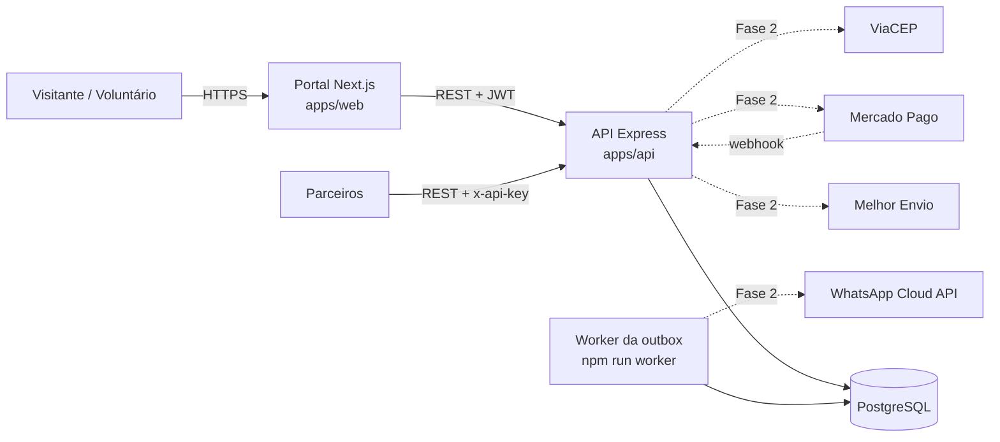

# Arquitetura — Bazar Solidário Digital

## Visão geral dos componentes

A API segue camadas por módulo: `routes → controller → service → repository (Prisma)`.
Integrações externas ficam em `src/integrations/` atrás de interfaces (`PaymentProvider`,
`ShippingProvider`, `CepProvider`, `NotificationProvider`), permitindo trocar a implementação real
por um mock via `INTEGRATIONS_MODE`.

## Decisões técnicas (Fase 1)

| Decisão                                                                                            | Justificativa                                                                                                                  | Disciplina                        |
| -------------------------------------------------------------------------------------------------- | ------------------------------------------------------------------------------------------------------------------------------ | --------------------------------- |
| Monorepo com npm workspaces e `packages/shared`                                                    | Tipos e schemas Zod únicos entre API e portal; validação idêntica no cliente e no servidor                                     | Tópicos Avançados em Programação  |
| Node ≥ 20 (deploy em 20 LTS)                                                                       | Compatibilidade com o ambiente dos integrantes sem perder suporte LTS                                                          | Tópicos Avançados                 |
| Express 5                                                                                          | Erros de handlers `async` chegam ao middleware de erro sem wrappers                                                            | Tópicos Avançados                 |
| Valores monetários em centavos (`Int`)                                                             | Evita erros de arredondamento de ponto flutuante                                                                               | Negócios Digitais                 |
| `Payment` ligado a exatamente um entre pedido, doação ou apadrinhamento                            | Uma só tabela de pagamentos para webhook único; regra garantida por `CHECK (num_nonnulls(...) = 1)` no banco                   | Sistemas Distribuídos             |
| `WebhookEvent` com `@@unique([provider, externalId])`                                              | Base da idempotência de webhooks (Fase 2)                                                                                      | Sistemas Distribuídos             |
| `NotificationOutbox` + worker separado                                                             | Padrão _transactional outbox_: pedidos nunca esperam notificação                                                               | Sistemas Distribuídos             |
| Problemas (ITIL) modelados como `Ticket` do tipo `PROBLEM`, com incidentes ligados por `problemId` | Gestão de problemas simples, sem tabela extra                                                                                  | Gestão de Serviços de TI          |
| `x-correlation-id` com `AsyncLocalStorage`                                                         | O id aparece em todos os logs (pino `mixin`) e poderá ser repassado às chamadas externas sem passar parâmetro por toda a pilha | Sistemas Distribuídos             |
| Erros no formato `{ error: { code, message, details? } }`                                          | Contrato estável para portal e parceiros; mensagens em pt-BR                                                                   | —                                 |
| Checagem estrutural de `ZodError` (não `instanceof`)                                               | O zod pode ser carregado em duas builds (CJS via `@bazar/shared` e ESM nos testes), o que quebra o `instanceof`                | Tópicos Avançados                 |
| Fotos como URLs (placeholders)                                                                     | Sem upload de arquivo; evita armazenamento externo e fotos de pessoas reais                                                    | —                                 |
| PostgreSQL local na porta **5433**                                                                 | Evita conflito com outros Postgres na 5432; o banco `bazar_test` é criado automaticamente para os testes                       | —                                 |
| Partner API key armazenada como hash SHA-256 + prefixo                                             | A chave em texto aparece só na criação; vazamento do banco não expõe chaves                                                    | Sistemas Distribuídos / Segurança |
| Dados pessoais mínimos + `consentAt`                                                               | Aderência à LGPD                                                                                                               | Governança                        |
