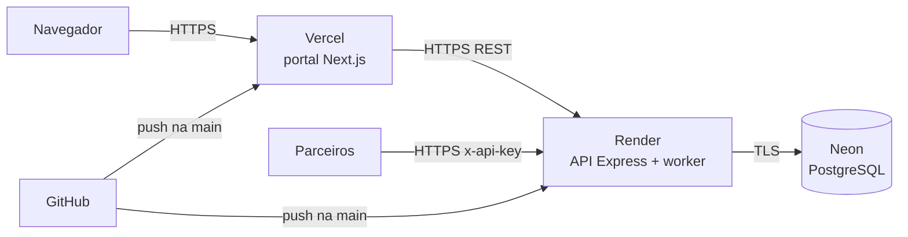

# Deploy — Bazar Solidário Digital

Tudo em planos gratuitos: **Neon** (PostgreSQL), **Render** (API + worker no mesmo processo) e **Vercel** (portal).



## Pré-requisitos

- Repositório no GitHub com este código.
- Contas gratuitas em <https://neon.tech>, <https://render.com> e <https://vercel.com> (login com o GitHub).

## 1. Banco — Neon

1. _New project_ → nome `bazar-solidario`, região _AWS São Paulo_ (ou a mais próxima), Postgres 16.
2. Copie a **connection string direta** (sem `-pooler`), com `?sslmode=require`.
3. Na sua máquina, crie `.env.production` a partir de `.env.production.example` e cole a string em `DATABASE_URL`.
   Escolha uma senha forte em `SEED_ADMIN_PASSWORD`.
4. Rode as migrations e os dados iniciais **contra o Neon**:

```bash
npm run prod:migrate      # cria as tabelas
npm run prod:seed         # catálogo S01–S08, animais, peças, campanhas, histórico, admin e parceiro demo
npm run prod:simulation   # 40 chamados simulados + relatório de SLA (evidência)
```

Guarde a **chave do parceiro demo** que o seed imprime (ela não é exibida de novo).

## 2. API — Render

1. _New_ → **Blueprint** → selecione o repositório. O Render lê o [`render.yaml`](../render.yaml).
2. Preencha as variáveis marcadas como `sync: false`:
   - `DATABASE_URL` — a mesma do Neon;
   - `CORS_ORIGIN` e `WEB_URL` — a URL do portal na Vercel (pode ajustar depois do passo 3);
   - `API_PUBLIC_URL` — a URL da própria API, ex.: `https://bazar-solidario-api.onrender.com`.
3. `JWT_SECRET` e `MERCADOPAGO_WEBHOOK_SECRET` são gerados automaticamente pelo Render.
4. Ao subir, o serviço aplica as migrations (`prisma migrate deploy`) e inicia a API com o worker no mesmo
   processo (`RUN_WORKER_IN_PROCESS=true`), pois o plano gratuito não tem _background worker_.
5. Teste: `https://<api>/health` deve responder `"status":"ok"` e `https://<api>/docs` abre o Swagger.

> **Plano gratuito do Render:** o serviço "dorme" após 15 min sem acesso e leva ~50 s para acordar.
> Antes de uma apresentação, abra `/health` uns minutos antes. Opcional: um monitor gratuito (ex.: UptimeRobot)
> chamando `/health` a cada 10 min mantém a API acordada.

## 3. Portal — Vercel

1. _Add New → Project_ → importe o repositório.
2. **Root Directory:** `apps/web` (o [`vercel.json`](../apps/web/vercel.json) já define instalação e build do monorepo).
3. Variáveis de ambiente:

| Variável               | Valor                                                  |
| ---------------------- | ------------------------------------------------------ |
| `NEXT_PUBLIC_API_URL`  | URL da API no Render                                   |
| `API_URL`              | mesma URL (usada nas páginas renderizadas no servidor) |
| `NEXT_PUBLIC_SITE_URL` | URL do portal na Vercel (metatags Open Graph)          |

4. _Deploy_. Depois, volte ao Render e confirme `CORS_ORIGIN`/`WEB_URL` com a URL final da Vercel.

## 4. Conferência

```bash
API=https://<api>.onrender.com
curl -s $API/health | jq .status                     # "ok"
curl -s -H "x-api-key: <chave do parceiro>" $API/api/public/v1/animals | jq .total
```

No portal: compre uma peça com Pix → **Simular pagamento aprovado** → o pedido vira _Pago_.

## 5. Evidências

```bash
cd tools/evidencias && npm install && npx playwright install chromium && cd ../..
WEB_URL=https://<portal>.vercel.app API_URL=https://<api>.onrender.com ADMIN_PASSWORD='<senha do seed>' npm run evidencias
```

As imagens vão para `docs/evidencias/img/`. Veja o checklist em [`evidencias.md`](evidencias.md).

## Segurança em produção

- HTTPS em todos os serviços (Vercel e Render emitem certificados automaticamente; o Neon exige TLS).
- Segredos só nos painéis da Vercel/Render e no `.env.production` local (ignorado pelo git).
- `INTEGRATIONS_MODE=mock`: nenhum pagamento real; o simulador `/api/dev/*` fica ativo para a demonstração.
  Para usar o sandbox do Mercado Pago, troque para `sandbox` e preencha as credenciais (ver [integracoes.md](integracoes.md)).
- A senha do admin de produção é definida no seed (`SEED_ADMIN_PASSWORD`); troque-a no painel depois da avaliação.
